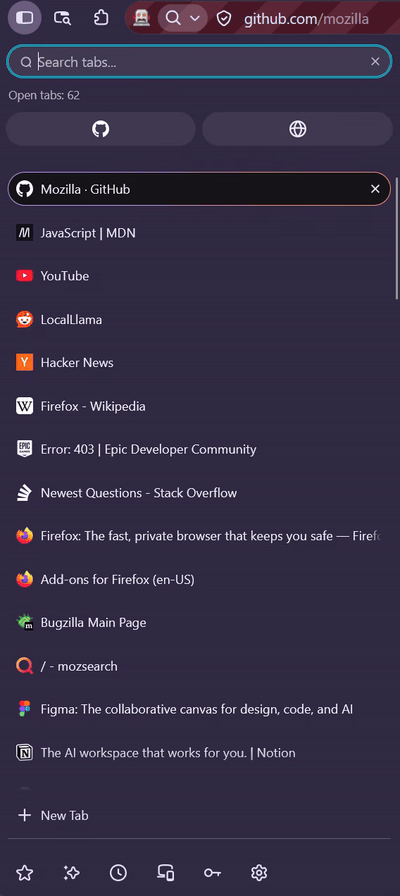

# Firefox Native Tab Search

A search field above Firefox's native vertical tab strip that filters open tabs
in real time. It runs on **stable Firefox** and does **not** need an extension,
an XPI, or any WebExtension API.

Type in the field and non-matching tabs are hidden with Firefox's native
`gBrowser.hideTab()`. Clear the field and only the tabs hidden by this session
come back. Active and pinned tabs always stay visible.

[](docs/demo.mp4)

*Short demo (GIF, muted). The original 12-second MP4 is in [`docs/demo.mp4`](docs/demo.mp4).*

## Requirements

- Windows 10 or Windows 11.
- **Stable Firefox 140 or newer** with native vertical tabs.
- Administrator rights for installation: Firefox usually lives in
  `C:\Program Files`, and Autoconfig files must sit next to `firefox.exe`.

Tested on Windows with stable Firefox 159.0: filtering and clearing,
pinned/active tabs, new tabs during a filter, external show, native tab groups,
collapsed sidebar, `Ctrl+Alt+F`, and multiple windows. Fuzzy matching,
Enter-to-open and the shortcut were re-verified end-to-end on stable Firefox
159.0.1 and Nightly 161.0a1.

## Install

1. Download or clone this repository (or the release ZIP).
2. Double-click **`install.cmd`**.
3. Approve the Windows UAC prompt.
4. Quit Firefox completely, then start it again.

The installer:

- finds stable Firefox automatically (Program Files, per-user installs, or the
  registry);
- checks that Firefox is 140 or newer;
- refuses to overwrite another `general.config.filename` setup;
- backs up this project's own previous files before updating;
- installs `firefox-native-tab-search.cfg` next to `firefox.exe`;
- adds `defaults/pref/zz-firefox-native-tab-search.js`;
- enables native vertical tabs as a *default* (`sidebar.verticalTabs=true`).
  If you explicitly turned vertical tabs off, your choice still wins.

To install into a non-standard location:

```powershell
.\install.ps1 -FirefoxDir "D:\Firefox"
```

## Use

- Click the field or press **Ctrl+Alt+F**.
- Type a title, URL or domain. Whitespace separates terms; every term must
  match.
- Matching is fuzzy: `ghd` finds *GitHub Docs*, `gihub` finds *GitHub*, and
  `ff` finds *Firefox*. A fuzzy term must start on a word boundary, so short
  queries do not match everything.
- Literal matches always win, so `mail` still finds *Gmail* and `hub` still
  finds *GitHub*.
- Press **Enter** to open the best match and clear the filter.
- Press **Esc** or click the clear button to restore the tabs.
- The panel follows the Firefox light or dark theme.
- **Active, pinned, and browser-protected tabs** cannot be hidden by Firefox and
  are reported by the counter.
- A tab you were on while it did not match stays visible for the session
  (`kept for return`).
- Tabs opened while the filter is active — including `+ New Tab` and links
  opened in the background — stay visible until the filter is cleared
  (`N new`).
- Native tab groups with no matching tabs are hidden while the filter is
  active. Their headers return when the filter is cleared, and your
  collapsed/expanded state is preserved.
- When the sidebar is collapsed, the panel becomes a single search icon.

### Fuzzy search

Fuzzy matching is on by default. Set `fnts.fuzzySearch` to `false` in
`about:config` for strict substring search; the change applies to the next
keystroke.

The counter names the tab that **Enter** will open, for example
`Found 1 of 8 tabs · ↵ GitHub Docs`. Hover it for the full title and the
per-category counts.

## Uninstall

Double-click **`uninstall.cmd`** and approve the UAC prompt. Then restart
Firefox.

The uninstaller removes:

- `firefox-native-tab-search.cfg`;
- `defaults/pref/zz-firefox-native-tab-search.js`;
- timestamped backups created by the installer.

It never touches your profile, bookmarks, history, or explicit preferences.
The `sidebar.verticalTabs` *default* disappears with the pref file. If you
enabled vertical tabs yourself, they remain enabled.

## How it works

Firefox has no supported way for a normal user script to access browser chrome.
This project uses the enterprise **Autoconfig** mechanism:

1. `defaults/pref/zz-firefox-native-tab-search.js` sets
   `general.config.filename`.
2. Firefox loads `firefox-native-tab-search.cfg` at startup with privileged
   chrome access.
3. The script injects the field into `#vertical-tabs` and manipulates tabs with
   `gBrowser` directly.

There is no background page, no extension messaging, no `eval`, and no remote
code. The installed script is generated from `src/core.js` and
`src/native-tab-search.js`.

## Limitations

- **Unsupported by Mozilla.** Autoconfig is an enterprise feature, and Firefox
  does not guarantee its internal DOM or APIs. A future Firefox update can break
  the integration.
- **A major Firefox update or reinstall may remove the files.** Run
  `install.cmd` again; it is safe and idempotent.
- **Administrator rights are required** for a normal Program Files install.
- **No persistence.** The filter is per window and ends when the window closes
  or Firefox restarts. Nothing is written to the profile.
- **Some tabs cannot be hidden.** Firefox blocks hiding the active tab and
  pinned tabs. The counter reports them as `can't be hidden`.
- **Short queries match broadly.** Fuzzy matching is deliberately permissive,
  so a one- or two-letter query can keep more tabs visible than a substring
  search would. The counter always shows the exact number of matches.
- **Vertical tabs are required.** The field lives inside the native vertical
  tab strip. Without vertical tabs there is no place to show it.

## Troubleshooting

- **No field after restart.** Make sure Firefox was fully closed (including
  background processes) and that native vertical tabs are enabled in
  Settings > Appearance. Check the Browser Console (`Ctrl+Shift+J`) for
  `[Native Tab Search]` messages.
- **The field disappeared after a Firefox update.** Run `install.cmd` again.
- **Another Autoconfig setup is installed.** Firefox supports only one
  `general.config.filename`. The installer stops instead of overwriting it and
  prints the lines to merge.
- **Nothing hides.** Verify that the tab is not active or pinned. The counter
  shows how many tabs Firefox refused to hide.
- **Ctrl+Alt+F does nothing.** Another program may already own that
  combination. Click the field instead; the shortcut is a plain XUL `<key>`
  and needs no extra permission.

## Development

```powershell
npm test          # unit tests for src/core.js
.\build.ps1       # build dist/firefox-native-tab-search.cfg
.\build.ps1 -Release
```

Test against a copy of Firefox without touching your main installation:

```powershell
robocopy "C:\Program Files\Mozilla Firefox" "$env:TEMP\ff-test" /E
.\install.ps1 -FirefoxDir "$env:TEMP\ff-test" -WhatIf   # preview, no changes
.\install.ps1 -FirefoxDir "$env:TEMP\ff-test"
```

## Security

- The script is local, readable, and generated from this repository's sources.
- No `eval`, `new Function`, remote JavaScript, telemetry, or network access.
- Firefox sandboxes Autoconfig scripts by default. The installer sets
  `general.config.sandbox_enabled=false` because the field needs chrome
  privileges (`Services`, `gBrowser`). This is the same privileged mechanism
  enterprise Firefox configurations use.
- The installer refuses to replace a foreign Autoconfig configuration and
  prints exactly what it writes.
- Autoconfig runs with browser-chrome privileges. Only install this from a
  source you trust, and review `src/` before installing.

## License

MIT. See [LICENSE](LICENSE) and [NOTICE](NOTICE). The native integration is
derived from [TabSearch](https://github.com/irvinm/TabSearch) by Mike Irvin.
